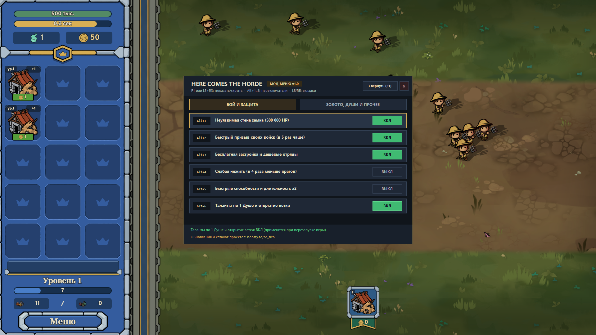
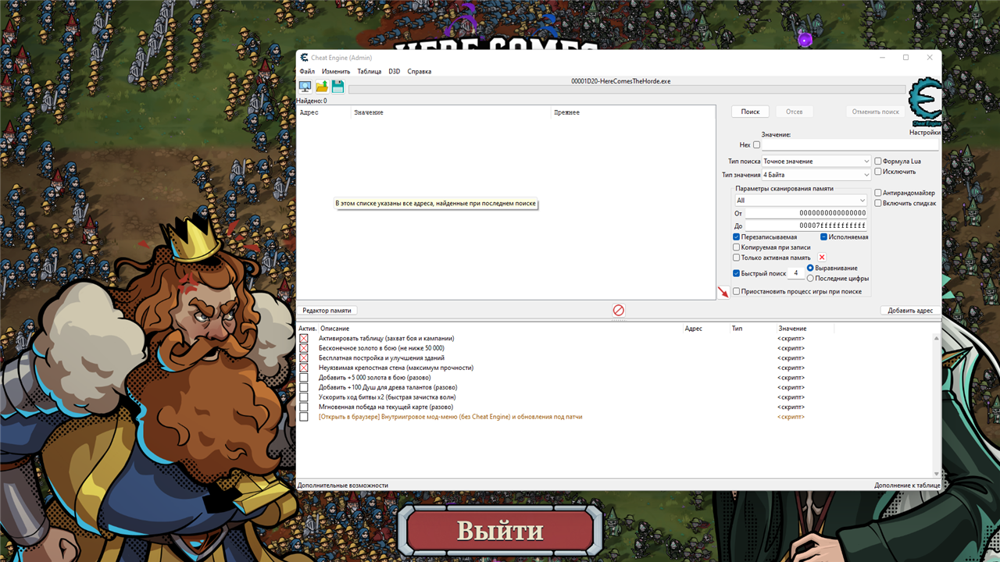

# Here Comes the Horde - Мод-меню и таблица .CT

Стена на 500 000 HP, быстрый призыв отрядов, бесплатная стройка, множители золота и душ, таланты за 1 душу и таблица Cheat Engine `v1.1` (версия `1.2.0`, сборка `26864614`, подходит и для Demo; Windows и Steam Deck).

## Скачать
- **[Скачать мод-меню v1.1 (ZIP)](https://github.com/neoru-droid/here-comes-the-horde-mod-ru/releases/download/v1.1.0/HereComesTheHorde-Trainer-RU-v1.1.zip)** · [Таблица .CT и другие файлы на GitHub Releases](https://github.com/neoru-droid/here-comes-the-horde-mod-ru/releases/tag/v1.1.0) · [Как установить](#установка)
- **[Страница игры и все архивы на Boosty](https://boosty.to/cd_tixo/posts/b3cdcac4-e365-460f-9d19-4536f8c2df0c)**
- **Ранний доступ и заказ своей игры:** новинки на 7 дней раньше (`120 ₽/мес на все релизы или разовый пост 150 ₽`), своя игра в очередь - `350 ₽`, разбор вне очереди - `750 ₽` на [Boosty](https://boosty.to/cd_tixo)

## Установка
1. **Windows:** закройте игру, распакуйте архив и запустите `HereComesTheHorde-Trainer-Setup.exe` -> **«Установить мод-меню»** *(при окне SmartScreen: «Подробнее» -> «Выполнить в любом случае»)*.
2. **Steam Deck / Linux:** распакуйте архив в одну папку и выполните `sh install-steamdeck.sh` рядом с `.exe`.
3. В релизной сборке игра читает `.ini` при запуске: после переключения опций в оверлее (`F1` / `L3 + R3`) перезапустите игру.
4. **Удаление:** кнопка **«Удалить и вернуть оригинал»** в том же установщике.

## Функции мод-меню (8 опций)

- `Alt+1` - Стена замка `500 000 HP`
- `Alt+2` - Быстрый призыв войск (`x5`)
- `Alt+3` - Бесплатная стройка и отряды за `1` золото
- `Alt+4` - Слабая нежить (`x4` меньше врагов)
- `Alt+5` - Быстрые способности и длительность `x2`
- `Alt+6` - Таланты по `1` душе и открытая ветка
- Стартовое золото (`x1 / +250 / +2500 / +25000`) и множитель золота/душ за врага (`x1 / x3 / x10 / x50`)

## Таблица Cheat Engine (`HereComesTheHorde_RU_v1.1.CT`)

Работает прямо в бою и на карте кампании без перезапуска: бесконечное золото (от `50 000`), бесплатная стройка, неуязвимая стена, разовые `+5 000` золота и `+100` душ, ускорение боя `x2` и мгновенная победа на карте.

## Обновления
- **[v1.1](https://github.com/neoru-droid/here-comes-the-horde-mod-ru/releases/tag/v1.1.0)** - исправлена `.CT` под `1.2.0` и Demo (смещение душ, захват указателей, стена и мгновенная победа).
- **[v1.0](https://github.com/neoru-droid/here-comes-the-horde-mod-ru/releases/tag/v1.0.0)** - первый выпуск: мод-меню Windows / Steam Deck, `.CT` и INI-пресеты.

Нашли баг после патча - пишите в [Issues](https://github.com/neoru-droid/here-comes-the-horde-mod-ru/issues).

[Сайт каталога](https://neoru-droid.github.io/) · [Каталог на Boosty](https://boosty.to/cd_tixo/posts/2a55d7e9-0f53-4d93-9f66-280981158dec) · [Telegram](https://t.me/neoru_droid) · [GitHub](https://github.com/neoru-droid) · [MIT](LICENSE) · Автор: `neoru-droid`
